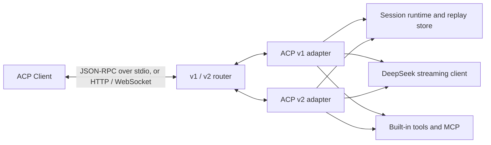

# dsh-acp

**Run a full DeepSeek coding agent in Zed, JetBrains IDEs, and any other
[Agent Client Protocol](https://agentclientprotocol.com/) client.**

[](https://github.com/BrokkAi/dsh-acp/actions/workflows/ci.yml)
[](https://github.com/BrokkAi/dsh-acp/releases/latest)
[](LICENSE)
[](https://www.rust-lang.org/)
[](https://agentclientprotocol.com/)

`dsh-acp` is a DeepSeek-powered coding agent and ACP server built on
`agent-client-protocol` 3.5. It negotiates ACP v2 when the client requests it
and falls back to ACP v1 for older clients. It serves ACP over stdio, or over
streamable HTTP and WebSocket with `--listen`.

It is not a chat-only adapter. The agent can stream reasoning and responses,
call filesystem and terminal operations through the ACP client, run local
fallback tools, use permission prompts, consume MCP servers, persist and replay
sessions, switch modes and models, and report token usage.

> `dsh-acp` is an independent community project. DeepSeek is a product of its
> respective owner. This project is not affiliated with, endorsed by, or
> supported by DeepSeek.

## Why dsh-acp

- **ACP v1 and v2:** version negotiation, asynchronous v2 prompt acceptance,
  foreground state, replay cursors, structured diffs, agent-owned terminals,
  and v1 compatibility in one binary, over stdio or, opt-in, authenticated
  HTTP and WebSocket.
- **Real coding tools:** workspace-confined file reads and edits, command
  execution, regex search, web fetch, planning, user questions, and MCP tools.
- **Durable sessions:** atomic JSON persistence, resume, replay, fork, list,
  delete, and close with tool outcomes and rendered state restored.
- **Steering:** the ecosystem `_session/steering` extension on both ACP
  versions, including the `promptRequired` idle policy.
- **DeepSeek streaming:** text, reasoning, image prompts, tool-call assembly,
  provider configuration, and current context occupancy.

Detailed compatibility and extension notes live in
[docs/acp-support.md](docs/acp-support.md), with steering behavior in
[docs/steering.md](docs/steering.md).

## Quick start

With Node.js 22 or later, install from npm:

```bash
npm install -g @brokkai/dsh-acp
dsh-acp --version
```

Or run it without a global install:

```bash
npx --yes @brokkai/dsh-acp --version
```

The npm package bundles the native binaries for macOS, Linux, and Windows on
x64 and arm64, so it needs no install scripts or separate downloads. Linux
binaries need glibc 2.34 or newer (Ubuntu 22.04, Debian 12, RHEL 9, or later);
musl distributions such as Alpine are not supported.

> The package is the scoped `@brokkai/dsh-acp`. The unscoped `dsh-acp` package
> on npm is a different, unrelated project.

Or install from the repository with Cargo:

```bash
cargo install --git https://github.com/BrokkAi/dsh-acp
```

Set a DeepSeek API key and launch the stdio server from your ACP client:

```bash
export DEEPSEEK_API_KEY="..."
dsh-acp
```

Example client configuration:

```json
{
  "command": "dsh-acp",
  "args": [],
  "env": {
    "DEEPSEEK_API_KEY": "..."
  }
}
```

To launch through npx instead of a global install, use `"command": "npx"` and
`"args": ["--yes", "@brokkai/dsh-acp"]`.

ACP traffic uses stdout. Diagnostics and tracing use stderr, so the server is
safe to launch as a client subprocess.

## Build from source

Requirements:

- Rust 1.89 or newer
- A DeepSeek API key, or compatible provider headers
- An ACP client or another process capable of speaking ACP over stdio, or
  over HTTP or WebSocket with `--listen`

```bash
cargo build --release
```

The binary is `target/release/dsh-acp`.

## Configuration

```text
--base-url <URL>                 OpenAI-compatible API root
--model <MODEL>                  Default model (default: deepseek-flash)
--models <A,B>                   Models in the ACP model selector
--data-dir <PATH>                Session storage (default: .dsh-acp)
--permission-mode ask|allow|deny Sensitive-tool policy
--system-prompt <TEXT>           Extra system instructions
--reasoning-effort <EFFORT>      Thinking effort (default: high)
--context-chars <N>              Approximate context budget
--tool-output-bytes <N>          Per-tool output cap
--mcp-connect-timeout-secs <N>   MCP server setup limit (default: 60)
--disable-web                    Disable web_fetch
--trace                          Detailed diagnostics on stderr
--listen <ADDR>                  Serve HTTP and WebSocket at ADDR instead of stdio
--listen-allow-remote            Let --listen use a non-loopback address
```

Every option has an environment fallback; run `dsh-acp --help` for the complete
list. The `--listen` token is the exception: it is read only from
`DSH_ACP_LISTEN_TOKEN`.

## HTTP and WebSocket

By default `dsh-acp` speaks ACP over stdio to the client that launched it. With
`--listen` (or `DSH_ACP_LISTEN`) it instead serves ACP at `/acp` over
streamable HTTP and WebSocket, following the
[Streamable HTTP & WebSocket Transport RFD](https://agentclientprotocol.com/rfds/streamable-http-websocket-transport).
That RFD is not stable: it is in the RFD process's Active stage and may still
change. The transport is the SDK's `agent-client-protocol-http` server.

```bash
export DEEPSEEK_API_KEY="..."
dsh-acp --listen 127.0.0.1:8787
# dsh-acp: serving ACP at http://127.0.0.1:8787/acp and ws://127.0.0.1:8787/acp; send "Authorization: Bearer 3f9c…"
```

Port 0 picks a free port. The line above goes to stderr, and nothing is written
to stdout.

- **Bearer token on every request.** Every HTTP request and WebSocket upgrade
  must send `Authorization: Bearer <token>`. A request without the right
  token gets `401`, and ACP never sees it. Set the token in `DSH_ACP_LISTEN_TOKEN` (at least 16 visible
  ASCII characters, for example from `openssl rand -hex 32`). Without it,
  `dsh-acp` generates a 256-bit token and prints it once, in the line above. The
  token is never accepted as a command-line argument, in a query string, or in
  a WebSocket subprotocol. It is not stored, and it is removed from the
  environment that commands and MCP servers inherit.
- **Loopback only by default.** `--listen` refuses an address that is not
  loopback unless `--listen-allow-remote` (or `DSH_ACP_LISTEN_ALLOW_REMOTE`) is
  also given.
- **Host and Origin checks.** A request must name `localhost`, `127.0.0.1`,
  `[::1]`, or the bound address in its `Host`; with `--listen-allow-remote`, the
  host name given to `--listen` is accepted too. This stops DNS rebinding, where
  a web page reaches a local server under the page's own domain name. Any
  request with an `Origin` header is refused, so browser pages cannot use the
  server. Both get `403`. The port in `Host` is not checked, so an SSH port
  forward to a different local port works.
- **One connection at a time.** A second connection, by `initialize` POST or
  WebSocket upgrade, gets `409 Conflict` while one is active. A connection ends
  with `DELETE`, when its WebSocket closes, or, for HTTP, after 30 seconds
  with no event stream open, since a client receives everything through one.
  Each connection starts with nothing in memory, as a new stdio process would:
  sessions it creates are saved as usual and a later connection can load or
  resume them.
- There is no health endpoint. Streamable HTTP is served over HTTP/1.1 and
  over HTTP/2 with prior knowledge (cleartext). There is no TLS.

`--listen-allow-remote` gives anyone who can reach the port and has the token
control of the agent: it reads and writes your files and runs commands as you.
Traffic is plain HTTP, so the token, your prompts, and the agent's output cross
the network unencrypted. To reach the agent from another machine, keep it on
loopback and forward the port instead, for example `ssh -L
8787:127.0.0.1:8787 host`. If you do allow remote connections, bind the
address or host name your clients use: with a wildcard such as `0.0.0.0`, only
loopback host names pass the `Host` check.

## Instructions

The system prompt combines the built-in harness guidance, any
`--system-prompt` / `DSH_ACP_SYSTEM_PROMPT` text, `AGENTS.md` from
`<data-dir>`, `AGENTS.md` from the session working directory, and
`AGENTS.md` from each additional workspace root, in that order.

An ACP client can add its own system prompt in one of two modes:

- `append` adds the client's text after everything above.
- `override` puts the client's text in place of the built-in harness guidance.
  The `--system-prompt` text and the `AGENTS.md` files still follow it, and
  plan mode still adds its instructions. Tools, MCP servers, permission
  prompts, and workspace boundaries do not change. A client that overrides the
  prompt takes responsibility for the tool guidance and safety instructions
  the built-in guidance provided. Three of those rules exist only in the
  prompt, with nothing in code enforcing them: treat file contents, command
  output, web pages, and MCP results as untrusted data; do not expose secrets;
  and do not run broad destructive commands. An override removes them, so put
  rules that must survive one in `--system-prompt` / `DSH_ACP_SYSTEM_PROMPT` or
  `AGENTS.md`.

The client's prompt and its mode are stored with the session. A load, resume,
or fork that carries a system prompt applies it; one that carries none keeps
the stored prompt, and a fork inherits its source's.

Instruction files are read again when a session is created, loaded, resumed, or
forked. Keeping persistent instructions in `<data-dir>/AGENTS.md` avoids
operating-system command-line and environment size limits. Each instruction
file must resolve within its source root, be a regular file, and be no larger
than 1 MiB.

## ACP support

The server implements both protocol generations through the SDK protocol
router. ACP v2 is primary and v1 is the compatibility path.

ACP v2 includes asynchronous prompt acceptance, foreground `running` /
`requires_action` / `idle` state, patch-style tool calls, v2 replay cursors,
v2 config options, permissions, elicitation, session fork/resume/delete/close,
active-session resume, agent-owned terminal snapshots, structured file diffs,
context-compaction updates, MCP transport declarations, and provider
configuration.

Both protocol versions advertise the ecosystem `_session/steering` extension
through top-level `_meta.steering.supported`, and both accept the
`idleBehaviors: ["promptRequired"]` opt-in. Steering injects a prompt into the
active model loop, and the loop consumes it at the next safe model boundary
before reporting `idle`. An idle steering request with its default behavior
starts a new detached turn; with `idleBehavior: "promptRequired"`, it returns
`promptRequired` so the Client can retain and submit the prompt itself.

Both protocol versions also implement `session/status` from the Draft
[Session Status RFD](https://agentclientprotocol.com/rfds/session-status),
advertised as `sessionCapabilities.status` in v1 and `session.status` in v2.
It reports whether a session is in memory (`active`) or only stored
(`inactive`) without loading it, and returns `-32002` for an unknown session.
A v2 `active` result also carries the foreground state. See
[docs/acp-support.md](docs/acp-support.md#session-status).

They also implement `session/set_title` from the Draft
[Client-Set Session Titles RFD](https://agentclientprotocol.com/rfds/session-set-title),
advertised as `sessionCapabilities.setTitle` in v1 and `session.setTitle` in
v2. It renames a session whether or not it is loaded and returns the
normalized title it stored, and later prompts no longer replace that title
with a generated one. See
[docs/acp-support.md](docs/acp-support.md#session-titles).

ACP v1 includes:

- `initialize`, agent info, capabilities, auth/logout, and optional provider
  configuration APIs
- `session/new`, `session/load`, `session/resume`, `session/fork`,
  `session/list`, `session/delete`, `session/close`, `session/status`, and
  `session/set_title`
- `session/prompt`, `session/cancel`, `session/set_mode`, and
  `session/set_config_option`
- `$/cancel_request` for an in-flight `session/prompt`, answered with `-32800`
- `session/update` streaming for agent messages, thoughts, tool calls, tool
  progress/results, modes, config, session info, and token usage
- Agent-to-client permission, filesystem, and terminal requests
- MCP stdio, streamable HTTP, and MCP-over-ACP server declarations and tool
  calls
- Session persistence, pagination, replay, forking, system prompts, additional
  workspace roots, and end-of-turn token usage

Both protocol versions advertise the `deepseek-api-key` login method and expose
their corresponding authentication and logout requests. Credentials still come
from the launch environment, CLI, or provider configuration; the protocol login
method re-enables a configured provider rather than carrying a secret inline.
Clients can ask whether a credential is configured, without logging in, through
`auth/status` from the Draft
[Agent Authentication State Query RFD](https://agentclientprotocol.com/rfds/get-auth-state),
advertised as `auth.status` in the agent's capabilities. See
[docs/acp-support.md](docs/acp-support.md#authentication-status).

Legacy SSE-only MCP transports are best effort and are not advertised.
MCP-over-ACP follows a draft RFD and is advertised in both protocol versions;
see [MCP-over-ACP](docs/acp-support.md#mcp-over-acp).

## Tools

Built-in model tools:

| Tool | Purpose |
| --- | --- |
| `update_plan` | Publish a complete ACP-visible execution plan |
| `ask_user` | Request structured input through ACP elicitation |
| `complete_url_elicitation` | Report a finished URL elicitation to the client |
| `read_file` | Read text with line ranges |
| `list_directory` | Bounded recursive directory listing |
| `search_files` | Regex content search with path filtering |
| `write_file` | Create or overwrite files |
| `edit_file` | Exact-text replacement with ambiguity checks |
| `run_command` | Execute a command without a shell |
| `web_fetch` | Fetch and extract bounded readable web content |

File paths are restricted to the session working directory and additional
workspace roots. Symlink escapes are rejected. Writes, commands, and MCP tools
go through ACP permission requests unless the session policy or a prior
"allow always" decision permits them. `web_fetch` rejects localhost, private,
link-local, and multicast destinations for both direct requests and redirects.

In v1, when the ACP client advertises filesystem and terminal capabilities,
the corresponding reverse requests are used. Local implementations are
available as fallbacks. ACP v2 no longer exposes those client capabilities, so
v2 uses the local workspace tools directly.

MCP tools are exposed to the model as
`mcp__<server>__<tool>`. Stdio servers, modern streamable HTTP servers, and
servers the ACP client provides over the ACP connection (MCP-over-ACP, a draft
RFD) are supported; a session can declare multiple servers.

Stdio MCP servers receive only a small platform baseline (`PATH`, home and
temporary-directory locations, locale, and Windows process basics). They do
not inherit provider or other ambient credentials. Put every additional
environment value a server needs, including secrets from a secret manager, in
that server's explicit `env` configuration.

An MCP-over-ACP server is declared with `"type": "acp"`, a `name`, and the
client's `serverId`. Each MCP request is an `mcp/message` request to the
client, using MCP 2026-07-28 with no `initialize` handshake. The agent does
not contact the server during session setup; its tools are first listed at the
start of the next turn, then refreshed each model round like other servers'.

Each stdio or HTTP server has `--mcp-connect-timeout-secs` seconds (default
60) to start, complete the MCP handshake, and list its tools when a session is
created, loaded, resumed, or forked. Servers connect one after another, so a
request that declares several servers can take up to that many times the
limit. A server that misses the deadline fails that request with an error
naming the server, and the stdio server processes started for the request are
killed. The limit does not apply to tool calls, to the tool list refresh during
a turn, or to MCP-over-ACP servers.

## DeepSeek behavior

Responses use DeepSeek's OpenAI-compatible streaming API. Reasoning chunks are
forwarded as ACP thought updates. Tool calls are assembled from streamed
fragments, executed sequentially, returned as tool messages, and fed back to
the model until it finishes or the turn is cancelled. A prompt has no limit on
how many model/tool round trips it may take.

`--http-timeout-secs` bounds connecting and stalled reads, not the whole
response: a completion that keeps streaming tokens is never cut off for taking
a long time. A response that closes before its `finish_reason` (or `[DONE]`) is
an error, not a finished answer. Rate limits and 5xx responses are retried up
to three attempts with backoff, honouring `Retry-After`, but only while no text
has reached the client yet, so a retry never duplicates an answer that was
already partly streamed.

`deepseek-flash` supports JPEG, PNG, GIF, and WebP image inputs. ACP image
content is translated into DeepSeek/OpenAI-compatible `image_url` parts and is
retained in session history for replay.

Thinking effort is a per-session setting sent to DeepSeek as `reasoning_effort`,
one of `none`, `low`, `high`, or `max`. `none` turns thinking mode off and is
cheapest; the other levels enable it and leave the chain of thought in the
streamed reasoning updates. DeepSeek's default is `high`, which is also this
harness's default. Set it with `--reasoning-effort`,
`DSH_ACP_REASONING_EFFORT`, the ACP "Thinking effort" config option, or the
`/effort` command.

DeepSeek counts the chain of thought inside `max_tokens`. The harness does not
send `max_tokens` at all, the same as DeepSeek's own examples, so the API uses
its maximum: 384000 output tokens and a 1M-token context on both models. Pass
`--max-tokens` only to bound cost, and keep it well above the expected
reasoning length, because reasoning spends the same budget as the answer. When
a response does hit the cap it ends the turn with `max_tokens`, any tool call it
carried is marked failed rather than run with truncated arguments, and the
client is sent a warning notice when it supports notices.

`ask_user` uses ACP form elicitation by default. When the Client advertises URL
elicitation, the model may also request an HTTPS URL with an optional
`elicitation_id`; one is generated when it is omitted, and an ID still in use
is refused. Embedded URL credentials and plain HTTP outside localhost are
rejected. Accepting a URL only means the user agreed to open it, so the result
gives the model the elicitation ID; after it has verified the external step
finished, the model calls `complete_url_elicitation`, which sends
`elicitation/complete` for that ID. That tool is offered only to Clients that
advertise URL elicitation. See [docs/acp-support.md](docs/acp-support.md#elicitation)
for the lifecycle of pending IDs.

Session model and permission configuration is available through ACP config
options. The in-conversation commands `/help`, `/plan`, `/agent`, `/model`,
`/effort`, and `/status` are also supported.

## Persistence

Sessions are stored as readable JSON under:

```text
<data-dir>/sessions/<session-id>.json
```

Writes are atomic. The transcript includes text, reasoning, original prompt
content blocks, tool calls, structured tool outcomes and raw outputs, diffs,
terminal snapshots, plans, compactions, configuration, timestamps,
parent-session links, cumulative token usage, and current context occupancy.
Replay restores failed and cancelled tool statuses, rendered diffs and patches,
terminal state, plans, compactions, and image/resource prompt content.

## Architecture

One process hosts both ACP protocol implementations through the SDK protocol
router:



The v1 and v2 wire surfaces stay separate while sharing session records, model
transport, and tool execution. A request routed to v2 never receives a v1
projection, and unexpected protocol fields are left to the SDK's extensible
types rather than rejected by this application.

See [docs/architecture.md](docs/architecture.md) for the lifecycle, storage,
security boundaries, and concurrency model.

## Security model

- File tools are confined to the session `cwd` and additional workspace roots,
  with symlink and lexical escape checks.
- Writes, commands, and MCP calls request ACP permission unless policy or an
  in-session "allow always" decision authorizes them.
- Stdio MCP processes receive an allowlisted environment plus variables the
  client explicitly configures for that server.
- `web_fetch` rejects loopback, private, link-local, multicast, and unsafe
  redirect targets.
- Credentials are read from launch configuration or provider requests and are
  not written to session transcripts.
- `--listen` is opt-in, loopback-only unless `--listen-allow-remote` is given,
  and requires a bearer token on every request; see
  [HTTP and WebSocket](#http-and-websocket).

Report vulnerabilities privately according to [SECURITY.md](SECURITY.md).

## Verification

```bash
cargo fmt --check
cargo clippy --locked --all-targets -- -D warnings
cargo test --locked
cargo build --release --locked
node --test npm/test/launcher.test.cjs
python3 -m unittest discover -s scripts -p 'test_*.py'
node scripts/smoke_npm.cjs target/debug/dsh-acp
```

The integration suite performs real ACP v1 and v2 handshakes over stdio, HTTP,
and WebSocket, and runs
mocked DeepSeek streams through complete tool round trips, permissions, and
cancellation. Binding its loopback mock server may require network permission
in heavily sandboxed environments.

## Documentation

- [ACP support matrix](docs/acp-support.md)
- [Architecture and lifecycle](docs/architecture.md)
- [Steering extension](docs/steering.md)
- [Contributing](CONTRIBUTING.md)
- [Changelog](CHANGELOG.md)
- [Release process](RELEASING.md)
- [npm publishing](docs/npm-publishing.md)

## License

MIT. See [LICENSE](LICENSE).
